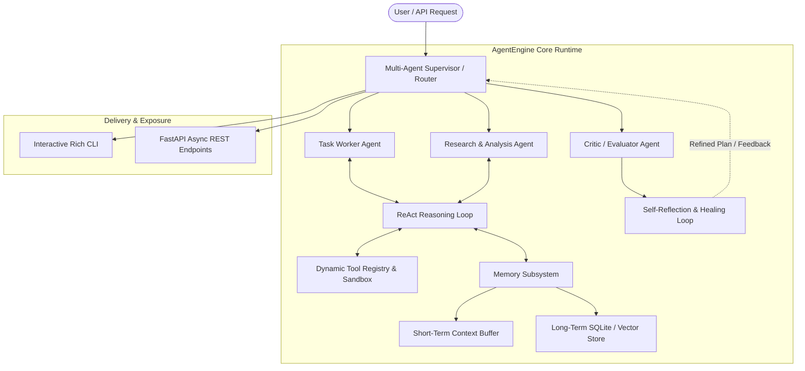

# 🧠 AgentEngine: Autonomous Multi-Agent Workflow Engine

> A modular, production-ready Multi-Agent AI System featuring dynamic tool calling, short/long-term memory persistence, self-reflection critic loops, and distributed agent collaboration.

[](LICENSE)
[](https://www.python.org/)
[](https://github.com/utkarshofficial999/Projects/actions)
[](docs/index.md)
[](tests/)

---

## 📖 Project Overview

**AgentEngine** is a modern, extensible agentic framework built in Python to orchestrate autonomous, goal-directed AI agents. Unlike standard single-prompt LLM wrappers, AgentEngine provides an enterprise-ready architecture for multi-agent reasoning, dynamic tool execution, conversational and semantic vector memory, self-correcting critique loops, and dual interface capabilities (CLI & FastAPI).

---

## 🏛️ System Architecture



---

## ✨ Key Features

- 🔄 **ReAct Execution Engine**: Autonomous thought-action-observation cycles that reason step-by-step before answering.
- 🛠️ **Dynamic Tool Calling & Sandboxing**: Type-safe tool definitions using Pydantic schemas with automatic parameter validation and execution guardrails.
- 💾 **Dual-Tier Memory Management**:
  - **Short-Term Context Buffer**: Sliding window conversational memory preserving token budgets.
  - **Long-Term Vector / SQLite Store**: Persistent semantic search and state retrieval across sessions.
- 👥 **Multi-Agent Collaboration**:
  - Supervisor pattern orchestrating specialized worker agents.
  - Asynchronous message bus with structured agent handoffs.
- 🧐 **Self-Reflection & Error Healing**: Integrated critic agent that evaluates intermediate agent outputs and triggers self-correction loops when errors or hallucinations occur.
- 🌐 **Production Interfaces**: Out-of-the-box support for both an interactive terminal CLI (`agent-engine cli`) and a high-performance asynchronous FastAPI server.

---

## 🚀 Quick Start

### 1. Installation

```bash
pip install agent-engine
```

### 2. Configuration

Create a `.env` file:

```env
OPENAI_API_KEY=sk-your-key-here
AGENT_ENGINE_LOG_LEVEL=INFO
```

### 3. Run CLI

```bash
agent-engine cli
```

### 4. Start API Server

```bash
agent-engine serve --port 8000
```

---

## 📂 Repository Structure

```
├── agent_engine/               # Core AgentEngine Package
│   ├── __init__.py             # Package exports & version
│   ├── cli/                    # Interactive CLI runner
│   │   ├── __init__.py
│   │   └── main.py             # CLI commands and REPL
│   ├── core/                   # Architecture, config & logging
│   │   ├── __init__.py
│   │   ├── config.py           # Pydantic v2 settings & environment engine
│   │   └── logging.py          # Structured JSON/console logging with structlog
│   ├── agents/                 # Agent implementations & supervisor logic
│   ├── tools/                  # Dynamic tool registry & sandboxed tools
│   └── memory/                 # Short-term buffers and long-term vector state
├── tests/                      # Automated Pytest suite
├── docs/                       # Architecture specifications & tutorials
├── state/                      # Roadmap state & memory DB
├── logs/                       # Structured log output
├── main.py                     # Entry point
├── pyproject.toml              # Project metadata
└── requirements.txt            # Dependencies
```

---

## 📚 Documentation

- [Getting Started](docs/tutorials/01_getting_started.md)
- [System Architecture](docs/architecture.md)
- [Custom Tool Development](docs/tutorials/02_custom_tools.md)
- [Multi-Agent Orchestration](docs/tutorials/03_multi_agent.md)

---

## 🧪 Testing

Run the test suite:

```bash
pytest tests/ -v
```

---

## 📄 License

MIT License. See [LICENSE](LICENSE) for details.

---

## 🤝 Contributing

Contributions are welcome! Please read [CONTRIBUTING.md](CONTRIBUTING.md) for guidelines.
