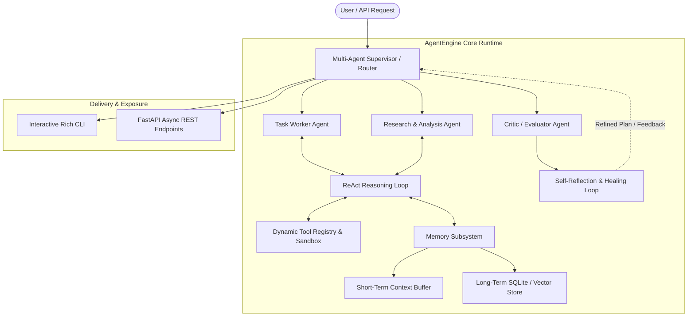
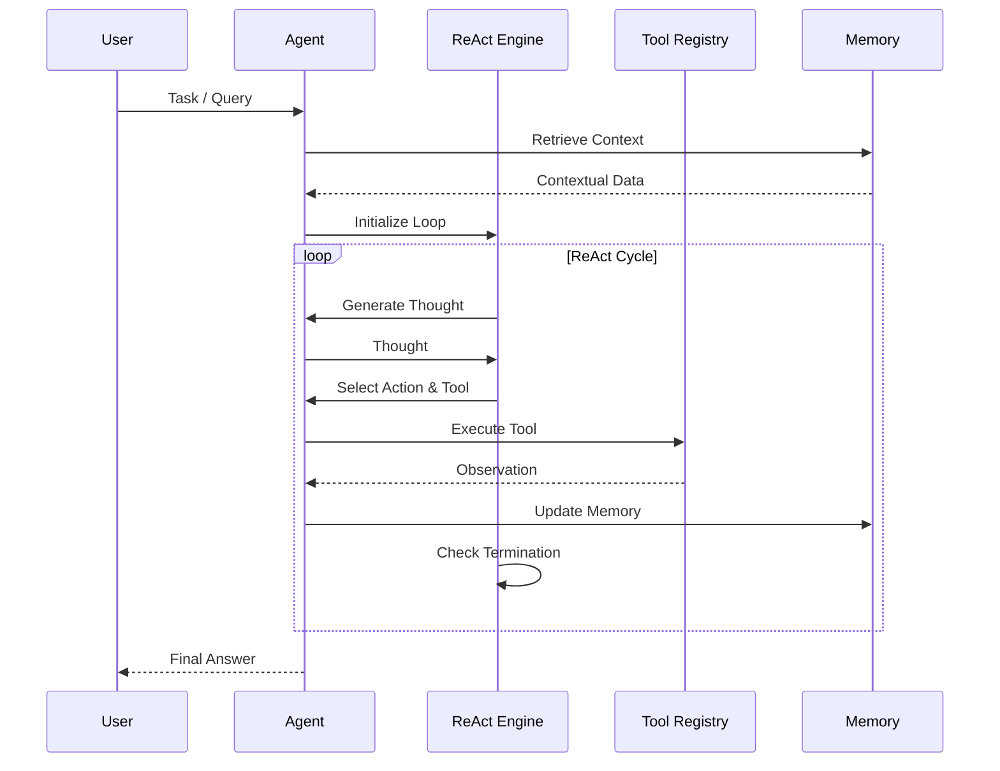
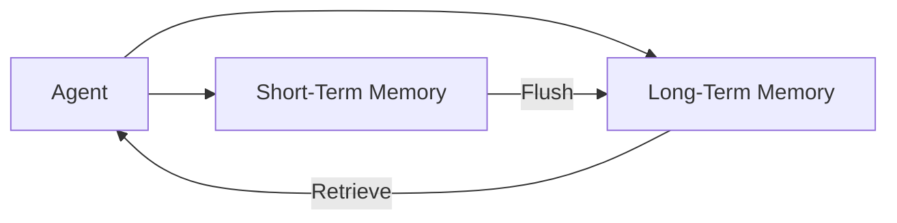
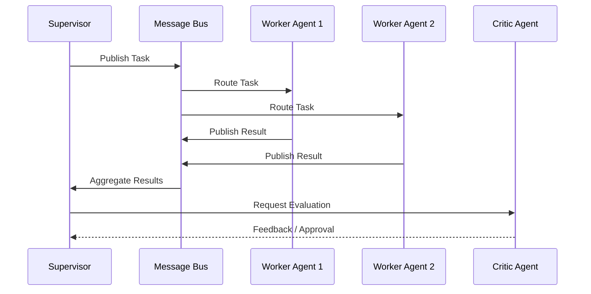
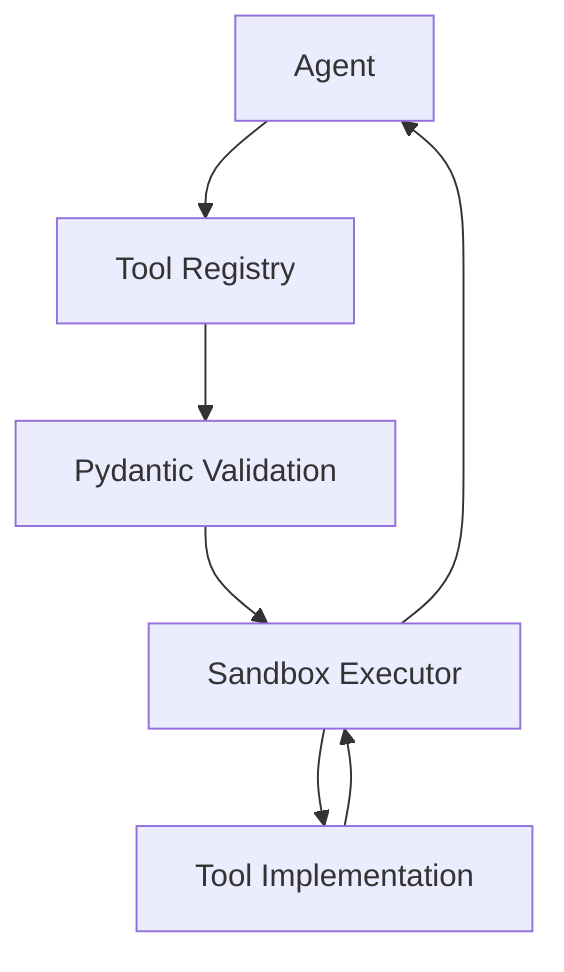

# System Architecture

This document details the internal architecture of AgentEngine, including data flow, component interactions, and design patterns.

## 🏛️ High-Level Diagram

## 🔄 ReAct Execution Loop

The core of AgentEngine is the **ReAct (Reasoning + Acting)** loop. Each agent instance runs this loop until a final answer is produced or a termination condition is met.

## 💾 Memory Flow

AgentEngine uses a dual-tier memory system:

1. **Short-Term Memory**: A sliding window buffer that maintains the most recent `N` interactions. This is used for immediate context awareness.
2. **Long-Term Memory**: A persistent SQLite or Vector Store that retains semantic embeddings and historical state across sessions.

## 👥 Multi-Agent Communication

Agents communicate via an asynchronous **Message Bus**. The Supervisor routes tasks to specialized agents and aggregates results.

## 🛠️ Tool Execution & Sandboxing

Tools are executed in a sandboxed environment to prevent side effects. The Tool Registry validates inputs using Pydantic schemas before execution.

